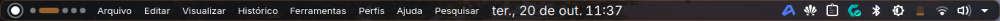

# dotfiles — CachyOS + KDE Plasma 6 (tiling, vidro e accent do wallpaper)

Configuração completa do meu desktop: **CachyOS (Arch)**, **KDE Plasma 6.8**,
tiling com foco segue o mouse e áreas de trabalho numeradas, mas mantendo a
essência do KDE — KRunner, Overview, Klipper, bloqueio de tela, etc.

O acento (cor de destaque) vem do wallpaper e se propaga para **borda da barra
superior, tema do Ghostty, realces do fastfetch e decoração das janelas**.



## O que tem aqui

| Camada | Escolha |
|---|---|
| Sistema | CachyOS (Arch), Wayland, Plasma 6.8 / KWin 6.8 / Frameworks 6.31 |
| Barra superior | Painel nativo + [Panel Colorizer](https://github.com/luisbocanegra/plasma-panel-colorizer) (vidro, borda na cor de destaque) |
| Dock | [Krema](https://github.com/bhyoo/krema) — estilo macOS, auto-hide, minúscula |
| Tiling | [Krohnkite](https://github.com/esjeon/krohnkite) (BTree), foco segue o mouse |
| Decoração | [Klassy](https://github.com/paulmcauley/klassy) (bordas accent + sombra) |
| Cores | OpalFruitsDark (Klassy) com `AccentColor` sincronizado ao wallpaper |
| Ícones | Tela-circle-dark |
| Cursores | WinSur-dark-cursors |
| Terminal | Ghostty 1.3 + tema gerado (`kde-accent`) que segue o destaque |
| Terminal info | fastfetch com realces em três tons do destaque |
| Lançador | KRunner (`SUPER+Espaço`) + app "Trocar wallpaper" (seletor nativo do KDE) |
| Atalhos | janelas/tiling com `SUPER` = `Meta`, 5 áreas de trabalho numeradas |

## Estrutura do repositório

O repositório **espelha o `$HOME`**: `.config/ghostty/config` é `~/.config/ghostty/config`,
`.zshrc` é `~/.zshrc` e assim por diante.

```
.
├── install.sh                 # instala pacotes + aplica os dotfiles + pós-instalação
├── save.sh                    # salva o estado atual do sistema de volta no repo
├── manifest.txt               # lista (única fonte de verdade) do que é gerenciado
├── packages/
│   ├── pacman.txt             # pacotes oficiais (explicitamente instalados)
│   ├── aur.txt                # pacotes do AUR (klassy, krema, krohnkite, colorizer, ulauncher...)
│   └── flatpak.txt            # flatpaks (opcional)
├── docs/TROUBLESHOOTING.md    # problemas conhecidos e como resolver
├── screenshots/               # prints
├── .config/                   # configurações (KDE, Ghostty, fastfetch, GTK, fish...)
│   ├── kdeglobals             # cores, esquema, accent, fontes, ícones
│   ├── kwinrc                 # tiling (Krohnkite), efeitos, foco, decoração
│   ├── kglobalshortcutsrc     # todos os atalhos
│   ├── plasma-org.kde.plasma.desktop-appletsrc   # painéis, applets, wallpaper
│   ├── kremarc                # dock
│   ├── ghostty/               # config + tema gerado
│   ├── fastfetch/config.jsonc
│   └── opencode/              # agentes, skills e regras globais do OpenCode
├── .local/
│   ├── bin/wallpaper-switcher # troca wallpaper e dispara o accent-sync
│   └── share/kde-rice/        # scripts + documentação do tema
│       ├── panel-colorizer.py # barra superior (vidro + borda accent)
│       ├── accent-sync.py     # gera tema do Ghostty e repinta o fastfetch
│       ├── kde-keybinds.py
│       ├── PAINEIS.md  ATALHOS.md  TEMA.md
```

## Instalação

Pré-requisito: Arch/CachyOS com KDE Plasma 6, `paru` e sessão Wayland.

```fish
git clone <este-repo> ~/dotfiles
cd ~/dotfiles
./install.sh              # pacotes + dotfiles + pós-instalação
```

Opções:

```fish
./install.sh --no-packages   # só os dotfiles (já tem os pacotes)
./install.sh --flatpak       # inclui packages/flatpak.txt
./install.sh --dry-run       # mostra tudo sem alterar nada
```

Depois saia e entre de novo na sessão (painel, KWin, atalhos e temas de janela
só entram em vigor no próximo login). **Passo a passo detalhado, com o que é
manual, está em [INSTALL.md](INSTALL.md).**

## O que **não** entra no repositório

| Item | Por quê | Como obter |
|---|---|---|
| Tema de ícones `Tela-circle-dark` | 43 MB de SVG/PNG | `paru -S tela-circle-icon-theme-git` |
| Cursores `WinSur-dark-cursors` | binário de terceiros, 91 MB | baixe em ~/.icons (veja [TROUBLESHOOTING](docs/TROUBLESHOOTING.md)) |
| Temas extras de Plasma/Aurorae não usados | ~17 MB de blobs | reinstale pelos links originais, se quiser |
| Wallpapers | ~160 MB de imagens, e não são configuração | ficam em `~/Imagens/Wallpapers` (use "Trocar wallpaper") |
| Dados de navegador, `~/.ssh`, `~/.gnupg`, KDE Connect, caches | privacidade/segredo | — |
| `~/.config/opencode/service.json` | contém senha do servidor local | recrie com suas credenciais |
| Histórico de shell, `~/.local/share/opencode` (sessões) | privacidade | — |

Os arquivos `.bak-*` (backups automáticos dos meus próprios ajustes) também ficam de fora.

## Atualizar o repositório

Depois de mexer em qualquer configuração no sistema:

```fish
cd ~/dotfiles
./save.sh                 # copia o estado atual do sistema para cá
git diff                  # confira
git commit -am "chore: ajustes"
```

`./save.sh --dry-run` lista o que seria copiado. Caminhos que já são symlink
para dentro do repo (instalação antiga com `stow`) são ignorados com segurança.

## Atalhos

Resumo (tabela completa em [ATALHOS.md](.local/share/kde-rice/ATALHOS.md)):

| Atalho | Ação |
|---|---|
| `SUPER+Enter` / `SUPER+Shift+Enter` | Ghostty / Brave |
| `SUPER+Shift+F` / `SUPER+Shift+N` | Dolphin / Kate |
| `SUPER+Espaço` | KRunner |
| `SUPER+Q` | Fechar janela |
| `SUPER+setas` | Foco entre janelas (tiling) |
| `SUPER+Shift+setas` | Mover janela |
| `SUPER+T` | Alternar flutuante |
| `SUPER+Ctrl+1..4` | Layout BTree / Tile / Floating / Monocle |
| `SUPER+1..5` | Ir para a área de trabalho N |
| `SUPER+Shift+1..5` | Mandar janela para a área N |
| `SUPER+W` / `SUPER+G` | Overview / Grid |
| `SUPER+L` | Bloquear sessão |
| `Print` | Flameshot |

## Como o tema segue o wallpaper

1. `wallpaper-switcher` aplica a imagem e chama `accent-sync.py`.
2. `accent-sync.py` lê `Colors:View DecorationFocus` (`kdeglobals`), gera o tema
   `~/.config/ghostty/themes/kde-accent` (fundo e paleta ANSI tingidos),
   repinta os realces do fastfetch e recarrega o Ghostty.
3. `panel-colorizer.py` aplica a borda da barra com `focusColor` = cor de
   destaque (alpha 0.28) e o vidro (acompanha ao vivo, sem reiniciar).

Detalhes em [TEMA.md](.local/share/kde-rice/TEMA.md) e
[PAINEIS.md](.local/share/kde-rice/PAINEIS.md).

## Problemas conhecidos

Blur do KWin quebrado em i915 + Mesa recente, teclas mortas (acentos) no GTK 4.20,
`Shift` sumindo dos atalhos no Wayland e o jeito certo de reiniciar o painel:
tudo em [docs/TROUBLESHOOTING.md](docs/TROUBLESHOOTING.md).

## Créditos

- Base inicial deste repositório: [dkorbelainen/dotfiles](https://github.com/dkorbelainen/dotfiles)
  (tema Utterly-Round, configs do micro e do ulauncher).
- [Klassy](https://github.com/paulmcauley/klassy), [Krohnkite](https://github.com/esjeon/krohnkite),
  [Krema](https://github.com/bhyoo/krema), [Panel Colorizer](https://github.com/luisbocanegra/plasma-panel-colorizer).
